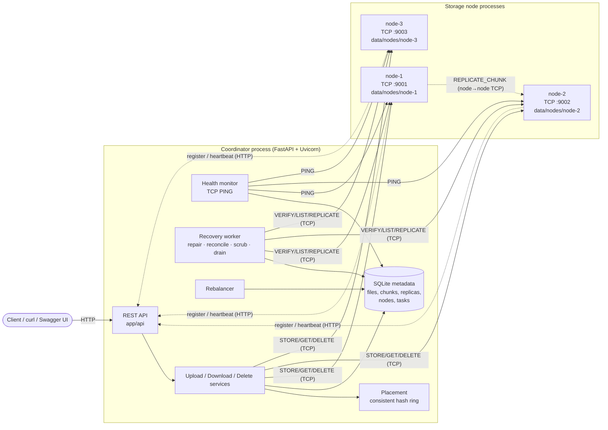
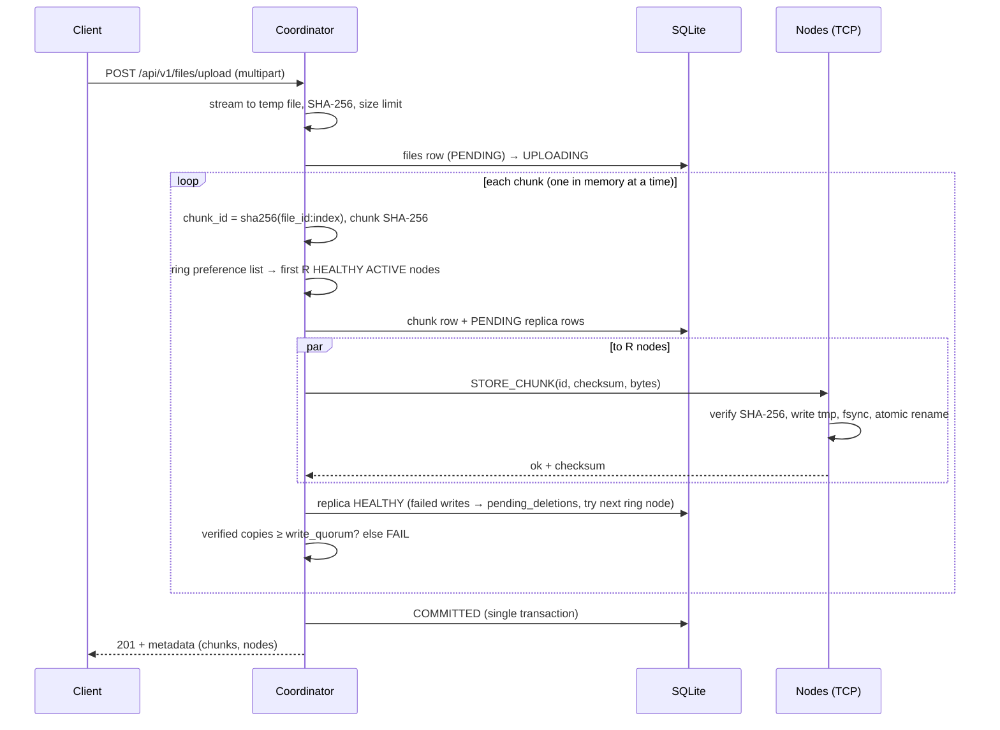
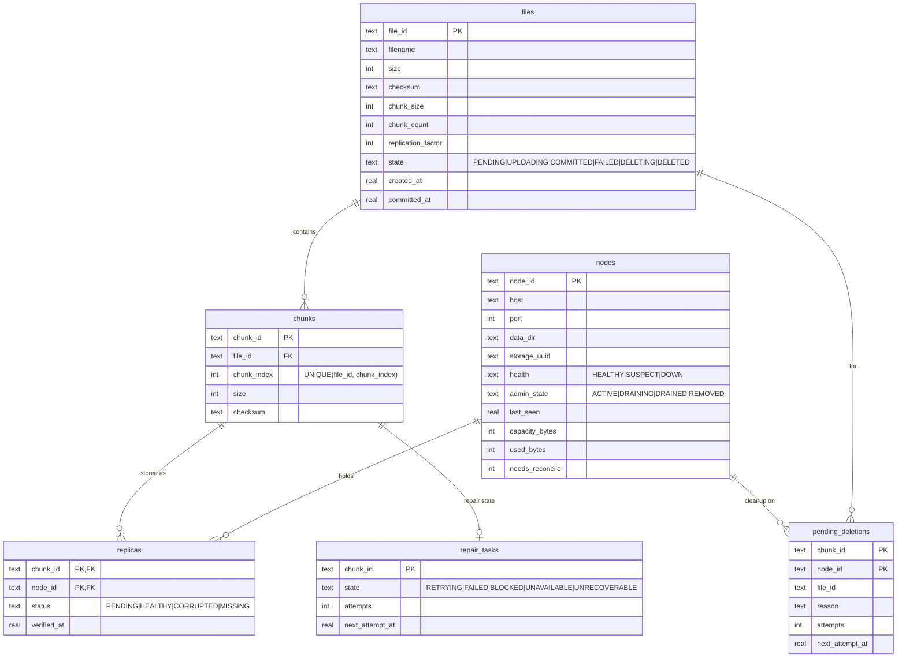

# Distributed File Storage System

A working distributed file store written in Python. Files are split into chunks, the chunks are
placed on independent storage-node **processes** with **consistent hashing**, **replicated** (default
3 copies) over a custom **binary TCP protocol**, verified with **SHA-256**, and **automatically
re-replicated** when a node crashes. A **FastAPI** coordinator exposes the REST API and keeps
authoritative metadata in **SQLite**.

Everything described here is implemented and exercised by the test suite and the end-to-end demo
against real processes. Known limitations are listed honestly at the end.

---

## Table of contents

1. [Project overview](#1-project-overview)
2. [Problem statement](#2-problem-statement)
3. [Features](#3-features)
4. [Architecture](#4-architecture)
5. [Component responsibilities](#5-component-responsibilities)
6. [Upload workflow](#6-upload-workflow)
7. [Download workflow](#7-download-workflow)
8. [Consistent hashing algorithm](#8-consistent-hashing-algorithm)
9. [Replica placement strategy](#9-replica-placement-strategy)
10. [Failure detection and recovery](#10-failure-detection-and-recovery)
11. [Metadata database schema](#11-metadata-database-schema)
12. [Socket protocol](#12-socket-protocol)
13. [REST API reference](#13-rest-api-reference)
14. [Installation](#14-installation)
15. [Configuration](#15-configuration)
16. [Cluster startup and shutdown](#16-cluster-startup-and-shutdown)
17. [Upload, download and deletion examples](#17-upload-download-and-deletion-examples)
18. [Failure simulation](#18-failure-simulation)
19. [Automated testing](#19-automated-testing)
20. [End-to-end demonstration](#20-end-to-end-demonstration)
21. [Benchmarking](#21-benchmarking)
22. [Troubleshooting](#22-troubleshooting)
23. [Security considerations](#23-security-considerations)
24. [Known limitations](#24-known-limitations)

---

## 1. Project overview

| | |
|---|---|
| Language | Python 3.11+ (developed and tested on 3.13) |
| Client API | FastAPI + Uvicorn, OpenAPI/Swagger at `/docs` |
| Coordinator ↔ node | Custom length-prefixed binary protocol over TCP (`socket`) |
| Metadata | SQLite (WAL, foreign keys, CHECK constraints, transactions) |
| Placement | Consistent hash ring, 64 virtual nodes per physical node (configurable) |
| Integrity | SHA-256 per chunk and per file, verified on write, read, repair and scrub |
| Concurrency | Threads (thread-per-connection nodes, thread pools in the coordinator) |
| Tests | pytest — 117 tests: unit, API, integration and failure scenarios with real processes |

The repository contains about 5,000 lines of application code and 2,400 lines of tests and scripts. Each storage node is a separate OS
process with its own port and data directory; nodes can be killed with `SIGKILL` and restarted
independently.

## 2. Problem statement

Storing files on one machine means one disk failure loses data and one process failure loses
availability. This project spreads each file across several machines (simulated locally as
independent processes) so that:

* any single node can crash **without the file becoming unreadable**;
* lost copies are **re-created automatically** on other nodes;
* corrupted bytes are **detected, never served**, and repaired from a good copy;
* adding or removing nodes **moves only a fraction of the data**;
* the system **never claims** a replica, deletion or recovery that did not physically happen.

## 3. Features

* **Chunking** – configurable chunk size; streaming (only one chunk in memory); empty, binary and
  multi-chunk files; exact byte reconstruction.
* **Consistent hashing** – SHA-256-based 64-bit ring with virtual nodes; replica preference lists
  over distinct physical nodes; placement-diff calculation for membership changes.
* **Replication** – real bytes on R distinct nodes; node-to-node transfer (`REPLICATE_CHUNK`) with
  coordinator-relay fallback; destination verified independently before success is recorded.
* **Upload state machine** – `PENDING → UPLOADING → COMMITTED | FAILED`; commit requires a write
  quorum of verified replicas per chunk; failed uploads are cleaned up.
* **Deletion lifecycle** – `COMMITTED → DELETING → DELETED`; offline nodes leave explicit
  `pending_cleanup` entries retried until they succeed.
* **Health monitoring** – active TCP probes with identity check; `HEALTHY → SUSPECT → DOWN` by
  configurable timeouts; HTTP heartbeats carry usage stats.
* **Recovery worker** – detects under-replication, copies from verified sources to eligible
  nodes, bounded exponential-backoff retries, distinguishes `UNDER_REPLICATED`, `UNAVAILABLE`
  (copies on down nodes) and `LOST` (no valid copy anywhere).
* **Reconciliation** – returning/restarted nodes are compared against metadata: missing → marked,
  corrupt → marked, surplus copies removed only when ≥ R valid copies exist elsewhere,
  under-replicated copies adopted, orphans from failed uploads garbage-collected.
* **Scrubbing** – optional full verification of every replica's bytes.
* **Drain / remove / rebalance** – graceful drain moves data off a node before removal; force
  removal never drops the last valid copy; rebalance copies-then-deletes to match the ring.
* **Persistence** – metadata survives coordinator restarts; chunk files survive node restarts;
  the virtual-node count is pinned so the ring cannot change unexpectedly.
* **Security basics** – shared-secret authentication on every TCP command and internal HTTP
  endpoint, loopback binding by default, path-traversal-proof chunk storage, filename sanitising,
  payload and upload limits.

## 4. Architecture



## 5. Component responsibilities

| Component | Module(s) | Responsibility |
|---|---|---|
| REST API | `app/api/*.py`, `app/main.py` | Validation, HTTP mapping of domain errors, OpenAPI docs |
| Runtime wiring | `app/runtime.py` | Builds and starts/stops every coordinator component |
| Configuration | `app/core/config.py`, `config.yaml` | Defaults → YAML → `DFS_*` env vars → CLI overrides |
| Metadata | `app/metadata/` | Schema, thread-local SQLite connections, all SQL in `repository.py` |
| Chunking / checksums | `app/storage/chunking.py`, `checksum.py` | Streaming chunker, chunk ids, verified reconstruction |
| TCP protocol | `app/storage/protocol.py` | Framing, `recv_exact`, limits, error codes |
| TCP client | `app/storage/socket_client.py` | One request per connection, timeouts, idempotent retries |
| Storage node | `app/storage/node_server.py`, `node_store.py` | Threaded TCP server; atomic, checksummed on-disk chunk store; registration/heartbeat |
| Node manager | `app/storage/node_manager.py` | Health monitor (TCP probes), client factory |
| Hash ring | `app/cluster/consistent_hashing.py` | Ring, vnodes, preference lists, placement diffs |
| Placement | `app/cluster/placement.py` | Ring of ACTIVE nodes; write candidates filtered by health |
| Membership | `app/cluster/membership.py` | Register (with TCP identity check), heartbeat, drain, remove |
| Rebalance | `app/cluster/rebalance.py` | Copy-verify-then-delete to match desired placement |
| Replication | `app/replication/manager.py` | Verified chunk copies, striped per-chunk locks |
| Policy | `app/replication/policy.py` | Pure functions: replica health assessment, repair planning |
| Recovery | `app/replication/recovery.py` | Background worker: cleanup, reconcile, scrub, repair, drain |
| Services | `app/services/*.py` | Upload, download, deletion, file views |
| Process manager | `app/process_manager.py` | Cross-platform launcher used by scripts, demo, benchmark, tests |

**Authority.** The coordinator's SQLite database is authoritative for *logical* state (which files
exist, which chunks they contain, where replicas should be). Storage nodes are authoritative only
for the bytes physically on their disks. The two are reconciled whenever a node registers, returns
from `DOWN`, or the coordinator restarts.

## 6. Upload workflow



**Atomicity guarantees.** A write across independent disks cannot be atomic, so the system makes
it atomic *for readers*: a file is visible and downloadable only after `COMMITTED`, which is set in
one SQLite transaction after every chunk has at least `write_quorum` (default 2) replicas whose
bytes the receiving node verified. Every location that might hold bytes is recorded *before* the
write (`PENDING` replica row), so on failure the file becomes `FAILED` and all those locations are
queued for physical deletion. If the coordinator crashes mid-upload, start-up finds the file in
`PENDING`/`UPLOADING`, fails it and queues the same cleanup. Committed chunks with fewer than R
copies are reported as under-replicated and repaired in the background.

**Limitations.** Between a replica write and its metadata row, a coordinator crash can leave bytes
that metadata never recorded; reconciliation deletes such orphans after `orphan_grace_seconds`.
A client that loses its connection after `COMMITTED` does not learn the file id (no idempotency key
on uploads).

## 7. Download workflow

1. File must be `COMMITTED` (`DELETING` → 409, unknown/`DELETED` → 404).
2. Chunks are read in index order; for each chunk the `HEALTHY` replicas are ordered by node health
   (HEALTHY, SUSPECT, DOWN last) then ring preference.
3. `GET_CHUNK` over TCP; the coordinator recomputes SHA-256 and compares with metadata. A mismatch
   marks the replica `CORRUPTED`; `NOT_FOUND` marks it `MISSING`; unreachable nodes are skipped.
   The next replica is tried.
4. Bytes are written to a private temp file; the whole-file SHA-256 is checked.
5. Only then is the file streamed (`FileResponse`) with `X-Checksum-SHA256` and
   `X-Chunks-Served-By` headers; the temp file is deleted afterwards.

A client therefore receives either the exact original bytes or an error: `503 CHUNK_UNAVAILABLE`
(valid copies exist only on unreachable nodes) or `500 DATA_LOSS` (every known copy is corrupt or
missing). It never receives a truncated or corrupted body.

## 8. Consistent hashing algorithm

* Hash: first 8 bytes of SHA-256 as an unsigned 64-bit integer (deterministic across processes and
  platforms, unlike Python's `hash`).
* Each physical node `n` owns `virtual_nodes` points at `H("n#0") … H("n#V-1")`, kept in a sorted
  array; lookups use binary search.
* A chunk id maps to the first point clockwise from `H(chunk_id)`; its **preference list** continues
  clockwise, skipping points whose physical node was already chosen.
* Adding a node takes over only the arcs in front of its points. The unit test
  `test_adding_a_node_moves_only_a_fraction_of_keys` measures this on 10,000 keys: going from 4 to 5
  nodes moves 10–30 % of primaries (ideal 20 %), every moved key moves *to* the new node, and
  `hash % N` would move at least 3× as many.
* The ring contains nodes whose admin state is `ACTIVE`. Health does **not** change membership
  (that would reshuffle placement on every blip); it only filters write targets.
* The vnode count is stored in `cluster_meta` on first start and reused afterwards, so a config
  change cannot silently remap every chunk.

## 9. Replica placement strategy

* **Desired placement** of a chunk = the first R nodes of its preference list.
* **Writes** go to the first R *HEALTHY* members of the list; if a write fails, the next node in
  the list is tried, so placement stays deterministic and close to the desired set.
* Replicas are always on **distinct physical nodes**; the ring never returns a node twice.
* **Desired vs. achievable** are reported separately: with R = 3 and only two eligible nodes,
  `GET /api/v1/cluster/replication/status` reports `max_distinct_copies_possible: 2` and
  `replication_factor_achievable: false`, and affected chunks stay `UNDER_REPLICATED` (repair task
  `BLOCKED`) until another node joins. The system never records a third copy it does not have.
* **Repairs** choose destinations in ring-preference order among HEALTHY ACTIVE nodes not already
  holding a valid copy. A node holding a copy marked `CORRUPTED`/`MISSING` is eligible (the repair
  overwrites it); a node holding an *unavailable* copy (node `DOWN`) is not, to avoid duplicate
  logical replicas when it returns.

## 10. Failure detection and recovery

**Detection.** The coordinator PINGs every node over TCP every `health_check_interval`; the reply
must carry the expected `node_id`. Health is derived from time since the last successful probe:
≤ `suspect_timeout` HEALTHY, ≤ `failure_timeout` SUSPECT, otherwise DOWN. A single slow request
never marks a node down. SUSPECT nodes keep counting as replica holders (no premature repairs).
DOWN means *unavailable*, not *data lost*: replicas there are reported `UNAVAILABLE` and are
re-verified when the node returns.

**Replica states.** `HEALTHY` (verified), `PENDING` (write in flight), `CORRUPTED` (checksum
mismatch), `MISSING` (node reachable, file gone); plus derived `UNAVAILABLE` (node DOWN).
**Chunk states:** `OK`, `UNDER_REPLICATED`, `UNAVAILABLE`, `LOST`.

**Recovery cycle** (`app/replication/recovery.py`), run every `recovery_interval`, immediately when
a node goes DOWN or returns, and on `POST /api/v1/recovery/trigger`:

1. retry due **pending deletions**;
2. **reconcile** nodes flagged after registration / return / coordinator restart;
3. optional **scrub** (`VERIFY_CHUNK` of every replica);
4. **repair** every committed chunk: pick a verified source, `REPLICATE_CHUNK` source → destination
   (node-to-node TCP), destination re-verified with `VERIFY_CHUNK`, then the replica row is
   upserted. Source corrupt → marked and next source; destination failure → next destination;
   errors → task `RETRYING` with exponential backoff, `FAILED` after `recovery_max_attempts`
   (a forced trigger retries it); nothing eligible → `BLOCKED`; no valid copy → `UNRECOVERABLE`;
5. progress **drains**.

Cycles are serialised by a lock and each chunk copy holds a striped per-chunk lock, so the
background worker, manual triggers, drains and rebalances never write the same chunk concurrently.
Replica rows are upserts keyed by `(chunk_id, node_id)` and node stores are idempotent, so
repeating any step cannot create duplicate logical replicas. If a file is deleted while a repair
copy is in flight, the late copy is detected in the same transaction and queued for deletion.

**Returning nodes** are reconciled, never wiped: a copy is deleted only when the chunk already has
≥ R valid copies elsewhere, or the chunk no longer exists in metadata (after a grace period).
A valid copy of an under-replicated chunk is adopted.

**The 3-node case.** With three nodes and R = 3, losing one leaves at most two distinct copies.
The cluster keeps serving the data and reports under-replication; once a fourth node registers,
recovery copies the missing replicas onto it (`test_three_nodes_one_failure_reports_under_replication_until_capacity_returns`).

## 11. Metadata database schema



Also `operations` (audit log of UPLOAD/DELETE/RECOVERY/REBALANCE runs) and `cluster_meta`
(schema version, pinned virtual-node count). Indexes cover file listing by state, replicas by node
and due cleanup work. Initialisation (`Database.initialize`) only creates missing objects; it never
deletes data. Destructive reset is a separate, explicit script.

## 12. Socket protocol

Every message is one frame:

```
+---------+------------+-------------+---------------------+------------------+
| "DFS1"  | header_len | payload_len | header (UTF-8 JSON) | payload (raw)    |
| 4 bytes | uint32 BE  | uint64 BE   | header_len bytes    | payload_len bytes|
+---------+------------+-------------+---------------------+------------------+
```

* Reads use `recv_exact` (loops on `recv_into` until N bytes); writes use `sendall`.
* Limits: header ≤ 64 KiB; payload ≤ `max_payload_size` (checked before reading the body).
* Chunk bytes travel only in the payload (no JSON/Base64).
* Request header: `{"cmd", "req_id", "token", ...args}`. Response: `{"ok": true, "req_id", ...}` or
  `{"ok": false, "req_id", "error": {"code", "message"}}`.
* Nodes serve many frames per connection; the client uses one connection per request with connect
  and I/O timeouts and retries transport failures (all commands are idempotent).

| Command | Arguments | Payload in | Result |
|---|---|---|---|
| `PING` | – | – | `node_id`, `storage_uuid`, `used_bytes`, `chunk_count` |
| `STORE_CHUNK` | `chunk_id`, `checksum` | chunk bytes | `stored`, `already_present`, `checksum`, `size` |
| `GET_CHUNK` | `chunk_id` | – | `checksum`, `size` + payload bytes |
| `DELETE_CHUNK` | `chunk_id` | – | `deleted` (false if absent — idempotent) |
| `VERIFY_CHUNK` | `chunk_id`, `expected_checksum?` | – | `exists`, `valid`, `actual_checksum`, `recorded_checksum` |
| `LIST_CHUNKS` | – | – | payload: JSON list of `{chunk_id, size, checksum, mtime}` |
| `GET_NODE_STATUS` | – | – | usage, capacity, uptime |
| `REPLICATE_CHUNK` | `chunk_id`, `checksum`, `target_host`, `target_port`, `target_node_id` | – | node pushes its verified copy to the target |

Error codes: `BAD_REQUEST`, `AUTH_FAILED` (connection then closed), `UNKNOWN_COMMAND`,
`NOT_FOUND`, `CHECKSUM_MISMATCH`, `PAYLOAD_TOO_LARGE` (connection closed), `STORAGE_FULL`,
`REPLICATION_TARGET_FAILED`, `BUSY`, `INTERNAL`.

**On disk** each node keeps `chunks/<id[:2]>/<id>.chunk` plus a `.meta` sidecar (checksum, size).
Writes go to `tmp/`, are fsync'd and atomically renamed. Chunk ids must match
`[A-Za-z0-9_-]{8,128}` and resolved paths must stay under the chunk directory. `node_identity.json`
binds the directory to one `node_id` and a random `storage_uuid`.

## 13. REST API reference

Interactive docs: **http://127.0.0.1:8000/docs** (Swagger UI) and `/openapi.json`.

| Method | Path | Description |
|---|---|---|
| POST | `/api/v1/files/upload` | multipart `file`; 201 with file + chunk placement |
| GET | `/api/v1/files?limit=&offset=&name=` | committed files, paginated, filename substring filter |
| GET | `/api/v1/files/{file_id}` | metadata, per-chunk replica locations and health |
| GET | `/api/v1/files/{file_id}/download` | verified file bytes |
| DELETE | `/api/v1/files/{file_id}` | `DELETED`, or `DELETING` with `pending_cleanup` |
| POST | `/api/v1/nodes/register` | node registration (needs `X-Cluster-Token`) |
| POST | `/api/v1/nodes/{node_id}/heartbeat` | node usage stats (needs `X-Cluster-Token`) |
| GET | `/api/v1/nodes` · `/api/v1/nodes/{node_id}` | health, admin state, usage, replica count |
| POST | `/api/v1/nodes/{node_id}/drain` | start/continue drain; returns progress |
| DELETE | `/api/v1/nodes/{node_id}?force=` | remove a drained node (force: see §10/§24) |
| GET | `/api/v1/cluster/status` | node/file/chunk counts, settings, recovery summary |
| GET | `/api/v1/cluster/storage` | per-node usage, logical vs physical bytes |
| GET | `/api/v1/cluster/replication/status` | desired vs achievable RF, problem chunks |
| POST | `/api/v1/cluster/rebalance?dry_run=` | move data to match the ring (or show the plan) |
| GET | `/api/v1/recovery/status` | worker state, last cycle, repair tasks, pending deletions |
| POST | `/api/v1/recovery/trigger` | body `{"scrub": bool, "force": bool}`; runs one cycle |
| GET | `/health` | liveness |

Errors use one shape: `{"error": {"code": "...", "message": "...", "details": {...}}}`.

Example upload response (abridged, from a real run):

```json
{
  "file_id": "f4c0949e35a44f718bb017049278110b",
  "filename": "sample.bin", "size": 3000000, "chunk_count": 3, "chunk_size": 1048576,
  "checksum": "…64 hex…", "state": "COMMITTED", "replication_factor": 3,
  "replication": {"desired": 3, "min_healthy_replicas": 3, "chunk_status_counts": {"OK": 3}},
  "chunks": [
    {"index": 0, "chunk_id": "…", "size": 1048576, "status": "OK", "healthy_replicas": 3,
     "locations": [{"node_id": "node-2", "status": "HEALTHY", "node_health": "HEALTHY", "...": "..."},
                   {"node_id": "node-3", "status": "HEALTHY"}, {"node_id": "node-1", "status": "HEALTHY"}]}
  ]
}
```

## 14. Installation

```bash
git clone <your-repo-url> distributed-file-storage
cd distributed-file-storage
python -m venv .venv
# Linux/macOS:
source .venv/bin/activate
# Windows (PowerShell):
.venv\Scripts\Activate.ps1
pip install -r requirements.txt
```

No database setup is needed: the coordinator creates `data/coordinator/metadata.db` and its
schema on first start (idempotent, non-destructive).

## 15. Configuration

`config.yaml` holds defaults; any key can be overridden with `DFS_<KEY>` (e.g.
`DFS_REPLICATION_FACTOR=2`); `DFS_CONFIG` selects another YAML file. Important keys:

| Key | Default | Meaning |
|---|---|---|
| `cluster_secret` | dev default | shared secret for TCP + internal HTTP (**set `DFS_CLUSTER_SECRET`**) |
| `chunk_size` | 1 MiB | chunk size for new uploads |
| `replication_factor` | 3 | desired copies per chunk |
| `write_quorum` | 2 | verified copies per chunk required to commit |
| `virtual_nodes` | 64 | vnodes per node (pinned after first start) |
| `max_upload_size` / `max_payload_size` | 1 GiB / 64 MiB | request and TCP frame limits |
| `health_check_interval`, `suspect_timeout`, `failure_timeout` | 2 / 6 / 15 s | failure detection |
| `recovery_interval`, `recovery_max_attempts`, `recovery_backoff_*` | 5 s, 5, 1–60 s | repair worker |
| `orphan_grace_seconds` | 300 | age before unreferenced node chunks are deleted |
| `connect_timeout`, `io_timeout`, `client_retries` | 3 s, 30 s, 2 | TCP client |
| `node_capacity_bytes` | 10 GiB | per-node capacity (`--capacity-bytes` overrides) |

## 16. Cluster startup and shutdown

**Scripted (recommended):**

```bash
export DFS_CLUSTER_SECRET=$(python -c "import secrets; print(secrets.token_hex(32))")  # optional
python scripts/start_cluster.py --nodes 3        # coordinator :8000, nodes :9001-9003, detached
python scripts/cluster_status.py                  # health / replication / storage summary
python scripts/stop_cluster.py                    # stops all processes, keeps data
python scripts/reset_cluster.py --yes             # DESTRUCTIVE: wipes data/ (only way to reset)
```

Windows PowerShell: `$env:DFS_CLUSTER_SECRET = "..."` and the same `python scripts/...` commands.

**Manual (one terminal per process):**

```bash
export DFS_CLUSTER_SECRET=my-long-secret          # same value in every terminal
python -m app.main --port 8000
python -m app.storage.node_server --node-id node-1 --port 9001 --data-dir data/nodes/node-1 --coordinator-url http://127.0.0.1:8000
python -m app.storage.node_server --node-id node-2 --port 9002 --data-dir data/nodes/node-2 --coordinator-url http://127.0.0.1:8000
python -m app.storage.node_server --node-id node-3 --port 9003 --data-dir data/nodes/node-3 --coordinator-url http://127.0.0.1:8000
```

Nodes register themselves; `Ctrl+C` stops a process gracefully.

## 17. Upload, download and deletion examples

```bash
# upload
curl -s -F "file=@./photo.jpg" http://127.0.0.1:8000/api/v1/files/upload | python -m json.tool
FID=<file_id from the response>

# metadata, list, download
curl -s http://127.0.0.1:8000/api/v1/files/$FID | python -m json.tool
curl -s "http://127.0.0.1:8000/api/v1/files?limit=20&offset=0&name=photo"
curl -s -o downloaded.jpg http://127.0.0.1:8000/api/v1/files/$FID/download
cmp photo.jpg downloaded.jpg && echo identical

# delete
curl -s -X DELETE http://127.0.0.1:8000/api/v1/files/$FID
# -> {"file_id":"...","state":"DELETED","deleted_replicas":9,"pending_cleanup":[]}
```

These exact commands were run against a 3-node cluster during development (3,000,000-byte random
file → 3 chunks, byte-identical download, `DELETED` with 9 replicas removed).

## 18. Failure simulation

```bash
python scripts/start_cluster.py --nodes 4
curl -s -F "file=@./big.bin" http://127.0.0.1:8000/api/v1/files/upload > up.json

python scripts/node_ctl.py kill node-2          # SIGKILL (TerminateProcess on Windows)
python scripts/cluster_status.py                # node-2 SUSPECT, then DOWN after failure_timeout
curl -s -o out.bin http://127.0.0.1:8000/api/v1/files/$FID/download   # still works
curl -s http://127.0.0.1:8000/api/v1/cluster/replication/status       # repaired onto node-4
python scripts/node_ctl.py start node-2         # returns; reconciled, stale copies trimmed

# corruption: flip a byte in any chunk file, then scrub
python -c "import pathlib;p=next(pathlib.Path('data/nodes/node-1/chunks').glob('*/*.chunk'));b=bytearray(p.read_bytes());b[0]^=255;p.write_bytes(bytes(b))"
curl -s -X POST -H "Content-Type: application/json" -d '{"scrub": true}' http://127.0.0.1:8000/api/v1/recovery/trigger

# graceful removal
curl -s -X POST http://127.0.0.1:8000/api/v1/nodes/node-3/drain
curl -s -X DELETE http://127.0.0.1:8000/api/v1/nodes/node-3

# add capacity and rebalance
python scripts/node_ctl.py add node-5 --port 9005
curl -s -X POST "http://127.0.0.1:8000/api/v1/cluster/rebalance?dry_run=true"
curl -s -X POST http://127.0.0.1:8000/api/v1/cluster/rebalance
```

With the default timeouts, DOWN is declared ~15 s after a crash; set `DFS_FAILURE_TIMEOUT` (and
`DFS_SUSPECT_TIMEOUT`) lower before `start_cluster.py` for faster demos.

## 19. Automated testing

```bash
python -m pytest                       # everything (≈1.5 min)
python -m pytest tests/unit            # pure logic + real loopback sockets, ≈10 s
python -m pytest tests/api             # FastAPI app + in-process TCP node servers
python -m pytest -m integration        # real coordinator + node processes
python -m pytest -m failure            # crash / corruption / partial-failure scenarios
```

| Suite | Tests | What is real |
|---|---|---|
| `tests/unit` | 84 | chunking, hashing, ring, metadata (SQLite), policy, retry, validation; protocol and node server over real TCP sockets (partial reads/writes, bad frames, timeouts, auth, traversal, concurrency) |
| `tests/api` | 11 | FastAPI app + real TCP node servers in threads: validation, auth, limits, lifecycle, pagination, drain/remove |
| `tests/integration` | 9 | separate OS processes: placement on disk, byte-exact downloads, delete cleanup, coordinator restart (incl. simulated crash mid-upload), node restart, rebalance with real data movement, drain/remove |
| `tests/failure_scenarios` | 13 | `SIGKILL`ed nodes, detection, recovery onto spare nodes, safe return, 3-node under-replication, multiple failures, undetected-crash uploads, quorum failure cleanup, corruption, scrub, destination full, dead source fallback, partial deletes, unavailable vs lost |

No integration or failure test mocks the storage subsystem: nodes are real processes, failures are
real kills, corruption is real byte flips on disk. **Last full run: 117 passed** (Linux, Python 3.13.16).

## 20. End-to-end demonstration

```bash
python scripts/demo.py            # temp dir, cleaned up afterwards; exit code 0 = all checks passed
python scripts/demo.py --keep     # keep data and logs for inspection
```

It starts a coordinator and 4 node processes and performs the 20 steps: health wait, cluster
status, upload of a ~3 MiB random file, placement listing, on-disk byte verification of every
replica, download and checksum comparison, `SIGKILL` of the busiest node, failure detection,
download from survivors, background re-replication, verification of the new replica files,
restart of the crashed node, reconciliation check, deletion, and verification that no chunk
files remain. Each step inspects real state; a failed check exits with status 1.

Excerpt from a real run:

```
[12] Crash node-1 with SIGKILL (no drain); it holds 13 replica(s)
[13] Wait for failure detection
    [ok] node-1 marked DOWN after 3.19s
[14] File remains downloadable from surviving replicas
    [ok] download after failure is byte-identical
[15] Wait for the background recovery worker to re-replicate
    [ok] replication factor 3 restored 3.25s after the crash (without restarting node-1)
[17] Restart node-1 (same port and data directory)
    [ok] node-1 rebuilt its inventory from disk after the crash (13 chunks)
[18] Verify the returning node is reconciled safely
    [ok] each chunk still has exactly 3 healthy, distinct replicas
    stale copies removed from node-1: 13
[19] Delete the file
    state=DELETED deleted_replicas=39 pending=0
DEMO PASSED
```

(The demo uses a 3 s failure timeout; production defaults are longer.)

## 21. Benchmarking

```bash
python scripts/benchmark.py                                   # ~1 minute
python scripts/benchmark.py --sizes 1M,64M --repeat 5 --concurrency 16
```

Measures upload/download latency and throughput per size, raw TCP chunk store/retrieve time,
replication overhead (RF=3 vs RF=1), crash-to-full-replication time and concurrent behaviour.
Results go to `bench-results/benchmark-<timestamp>.json`. See
[`docs/benchmark-results.md`](docs/benchmark-results.md) for one recorded run and its environment;
numbers depend entirely on your machine.

## 22. Troubleshooting

| Symptom | Cause / fix |
|---|---|
| `INSUFFICIENT_NODES` on upload | fewer HEALTHY nodes than `write_quorum`; check `scripts/cluster_status.py` and node logs in `data/logs/` |
| Node log: `registration rejected (401)` | node and coordinator have different `DFS_CLUSTER_SECRET` |
| Node log: `registration rejected (400) ... identity check` | coordinator cannot reach the node's TCP port (firewall, wrong `--advertise-host`) |
| `IDENTITY_MISMATCH` on node start | `--data-dir` belongs to another node id; use the right directory |
| `address already in use` | port taken; choose other ports or stop the old cluster (`stop_cluster.py`) |
| Node stays `DOWN` after restart | it must re-register; check its log and that the coordinator URL is right |
| Chunks `UNDER_REPLICATED`, tasks `BLOCKED` | fewer eligible nodes than R — add a node (`node_ctl.py add`) |
| Tasks `FAILED` | retries exhausted; inspect `last_error` in `/api/v1/recovery/status`, fix, then trigger with `{"force": true}` |
| File stuck in `DELETING` | a node holding replicas is offline; cleanup completes when it returns (see `pending_cleanup`) |
| `start_cluster.py` says a cluster is running | stale `run/cluster.json`; run `stop_cluster.py` |
| Windows: `Ctrl+C` does not stop a detached process | use `scripts/stop_cluster.py` |

## 23. Security considerations

* Every TCP command must carry the cluster secret (constant-time comparison); a failed
  authentication closes the connection. Node registration/heartbeat HTTP endpoints require
  `X-Cluster-Token`.
* Services bind to `127.0.0.1` by default.
* Chunk ids are validated and paths resolved and checked to remain inside the chunk directory;
  user filenames are metadata only, sanitised (directory parts, control characters, unsafe
  characters removed) and never used as filesystem paths.
* Limits on HTTP request size, upload size, TCP header size, TCP payload size, concurrent node
  connections and node capacity; timeouts on all network I/O.
* Temp files are created with `mkstemp` in private directories and removed on success, failure and
  start-up. Credentials and file contents are never logged.
* `run/cluster.json` (written by `start_cluster.py`) contains the generated secret and is created
  with mode 600; it is git-ignored, as are `data/` and `.env`.

**Not provided:** TLS (traffic, including the secret, is plaintext — fine on loopback, not on an
untrusted network); authentication/authorisation for the public file API (anyone who can reach the
coordinator can read and delete files); per-user quotas; protection against a malicious node that
knows the secret.

## 24. Known limitations

* **Single coordinator.** It is a single point of failure for the API and metadata (data on nodes
  survives, and a restarted coordinator resumes from SQLite). No leader election or metadata
  replication.
* **Not Byzantine-fault-tolerant; not production-grade.** Nodes are trusted once authenticated.
* **Recovery scans all committed chunks** each cycle (O(chunks)); fine for demos and moderate data,
  not for billions of chunks.
* **Downloads are staged** to a coordinator temp file before streaming so integrity can be
  guaranteed; this needs coordinator disk space equal to the file size and adds latency.
* **Uploads are staged** to a temp file on the coordinator too; multipart parsing buffers the body
  before the handler runs, so `max_upload_size` is also enforced via `Content-Length`.
* **One TCP connection per request** (no pooling) and the whole chunk is held in memory per
  request (bounded by `chunk_size`).
* **Force removal** (`DELETE /nodes/{id}?force=true`) drops a node's replicas immediately when
  every affected chunk still has another valid reachable copy; chunks become under-replicated until
  recovery repairs them. It refuses if the node holds the last valid copy of anything.
* **Removed nodes** cannot rejoin under the same id (registration returns 410); start them with a
  new id. Pending deletions targeting a removed node are dropped (its disk is outside the cluster).
* **Rebalance is manual** (`POST /cluster/rebalance`); new nodes receive data immediately only for
  new uploads and repairs.
* **Clock-based health** uses the coordinator's clock only; nodes' clocks are not compared.
* Multi-machine deployment is possible (`--host 0.0.0.0 --advertise-host <ip>`) but was only
  tested on a single machine.
* Docker support is not included.
